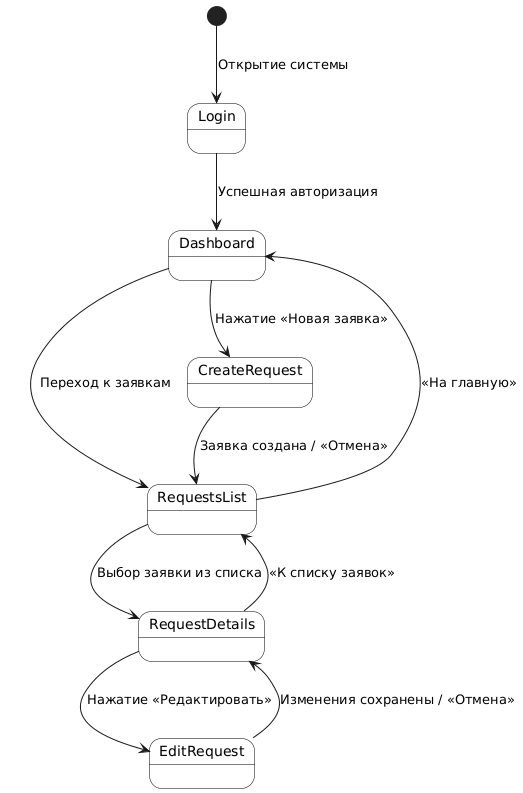
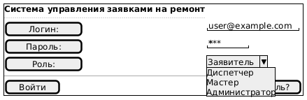
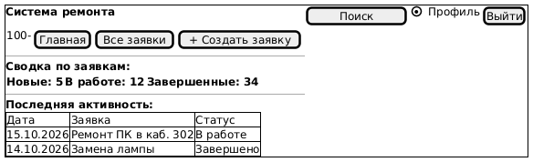
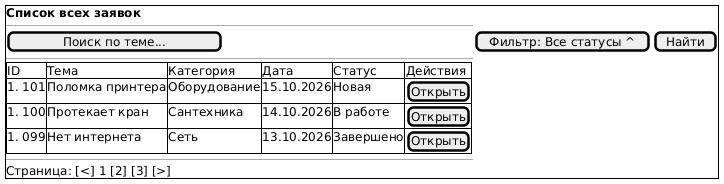
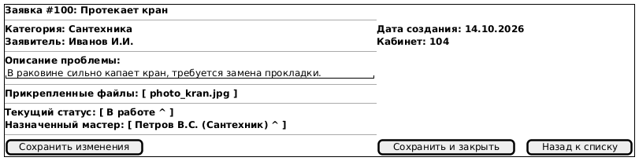
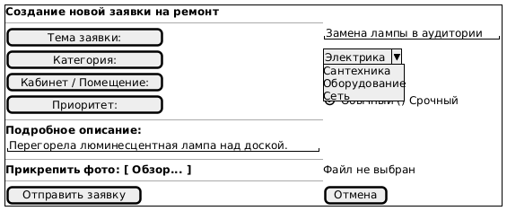

# Лабораторная работа №4

## Проектирование пользовательского интерфейса

**Курс:** Архитектура современных информационных систем  
**Студент:** Прилепская Ева (гр. ИТД-31)  
**Предметная область:** Система управления заявками на ремонт

---

## Цель работы

Изучить основные принципы проектирования пользовательских интерфейсов, разработать структуру экранов информационной системы, спроектировать навигацию и подготовить интерактивные или статические макеты страниц.

---

## 1. Структура и перечень экранов системы

Для информационной системы управления заявками на ремонт определены 5 основных экранов:

1. **Экран авторизации (Login Screen)**
   * *Назначение:* Аутентификация пользователей и разграничение прав доступа по ролям (Заявитель, Диспетчер, Мастер, Администратор).
   * *Элементы:* Форма ввода логина/пароля, выбор роли, кнопка «Войти», ссылка «Забыли пароль?».
   * *Действия:* Ввод учетных данных, авторизация в системе.

2. **Главная страница / Дашборд (Home / Dashboard)**
   * *Назначение:* Отображение сводной информации и актуальных статусов заявок.
   * *Элементы:* Шапка с профилем, статистика заявок (Новые, В работе, Завершенные), список последних активностей, кнопка быстрого создания заявки.
   * *Действия:* Переход к созданию заявки, фильтрация статистики, переход в каталог всех заявок.

3. **Экран списка заявок (Requests List Screen)**
   * *Назначение:* Просмотр, поиск и фильтрация всех зарегистрированных заявок.
   * *Элементы:* Поисковая строка, фильтры (по статусу, дате, мастеру), таблица/карточки заявок с кратким описанием и статусом.
   * *Действия:* Поиск заявки, применение фильтров, переход на страницу детального просмотра заявки.

4. **Экран детального просмотра заявки (Request Details Screen)**
   * *Назначение:* Просмотр полной информации по конкретной заявке и управление ее состоянием.
   * *Элементы:* Карточка с описанием проблемы, прикрепленные фото неисправностей, история смены статусов, блок назначения мастера, кнопка смены статуса.
   * *Действия:* Изменение статуса заявки, назначение мастера, загрузка дополнительных материалов/фото.

5. **Экран создания и редактирования заявки (Create / Edit Request Screen)**
   * *Назначение:* Оформление новой заявки на ремонт или внесение изменений в существующую.
   * *Элементы:* Форма ввода (название, категория поломки, подробное описание, адрес/кабинет), блок загрузки фото, кнопка «Сохранить / Отправить».
   * *Действия:* Заполнение полей формы, прикрепление файлов, сохранение заявки.

---

## 2. Навигация между экранами

Переход между экранами осуществляется по следующей логике:
* По умолчанию пользователь попадает на **Экран авторизации**.
* После успешной авторизации происходит переход на **Главную страницу (Дашборд)**.
* Из главного меню или шапки доступен переход к **Списку заявок** и на экран **Создания заявки**.
* Из **Списка заявок** при выборе конкретной записи осуществляется переход на экран **Детального просмотра заявки**.
* Из экрана детального просмотра возможен переход к **Редактированию заявки** или возврат к **Списку заявок**.

### Схема навигации:

---

## 3. Макеты и прототипы страниц (Wireframes)

При проектировании интерфейса были учтены основные принципы UX/UI: единообразие элементов, понятная навигация и минимальное количество действий для выполнения ключевых задач.

### 3.1. Экран авторизации

### 3.2. Главная страница (Дашборд)

### 3.3. Список всех заявок

### 3.4. Детальный просмотр заявки

### 3.5. Создание новой заявки

---

## Вывод

В ходе лабораторной работы были изучены базовые принципы проектирования пользовательских интерфейсов (UX/UI). Спроектирована логическая структура экранов и схема навигации для информационной системы управления заявками на ремонт, а также подготовлены wireframe-макеты ключевых страниц приложения.
